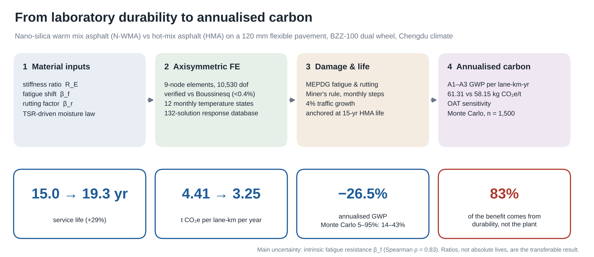
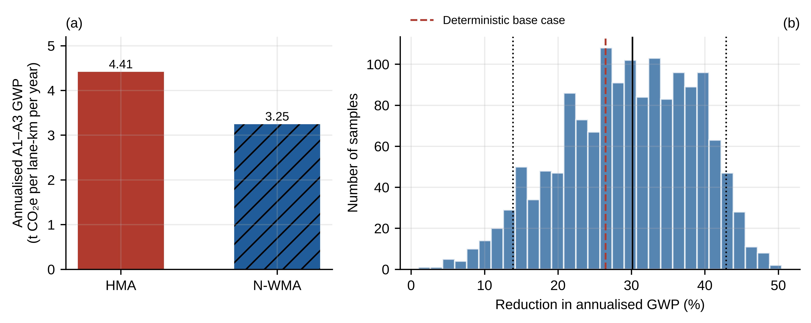
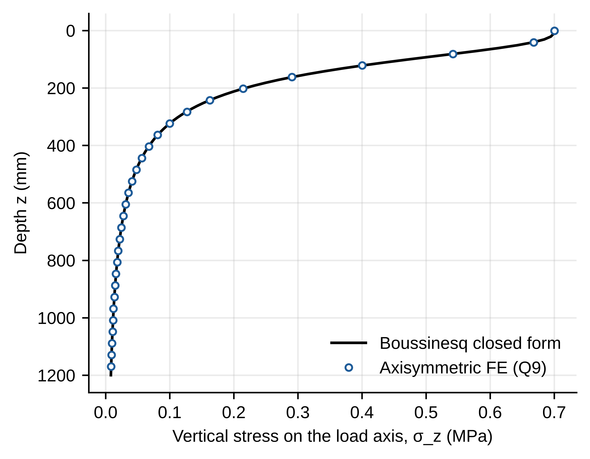
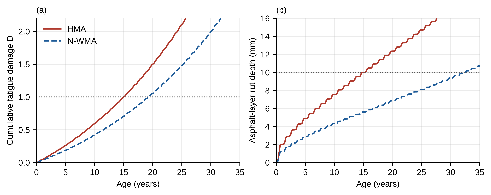

<h1 align="center">PaveCarbon</h1>

<p align="center"><b>From laboratory durability to annualised carbon</b><br>
An open finite-element and life-cycle framework for asphalt pavements, applied to nano-silica warm mix asphalt</p>

<p align="center">
<a href="https://github.com/syednafizreja/nano-wma-pavement-carbon/actions/workflows/tests.yml"></a>
<a href="LICENSE"></a>

<a href="https://orcid.org/0009-0002-7162-7890"></a>
</p>



This repository holds the complete code, inputs and outputs for:

> **Hasib, S. N. R.** *Coupled finite element and life cycle analysis of the annualised carbon benefit of nanosilica modified warm mix asphalt pavements.* Under review at *Discover Civil Engineering* (Springer Nature), 2026.

Every number, table and figure in the paper is regenerated by one command.

> **Note for reviewers.** The manuscript and Online Resource 1 refer to the Python package as `nwpc`, its working name at submission. It has since been renamed `pavecarbon`; `nwpc` remains as an alias, and the code and all results are identical.

## Why this exists

Nano-modified warm mix asphalt is usually defended on two separate grounds: lower plant emissions and better laboratory durability. The two claims are seldom connected. A durability gain measured on specimens is rarely carried through a pavement structure, so its carbon value stays an assumption. PaveCarbon makes that connection explicit and auditable. A change in a material input can be followed through modulus, strain, damage and service life to the annualised A1–A3 carbon of a lane-kilometre.

## The chain

```
material inputs ──► axisymmetric FE (Q9) ──► M-E damage & service life ──► annualised A1–A3 carbon
 R_E, β_f, β_r,      BZZ-100 dual wheel,       MEPDG fatigue & rutting,      per lane-km per year,
 TSR, τ, GWP         Witczak moduli, 12        Miner's rule, monthly         OAT sensitivity and
                     monthly states            traffic with growth           Monte Carlo (n = 1,500)
```

Equations, exactly as coded: [`docs/MODEL.md`](docs/MODEL.md).

## Results at a glance

| Quantity | HMA | N-WMA | Change |
| --- | ---: | ---: | ---: |
| Tensile strain at bottom of asphalt, as built | — | — | −3.6 to −5.5 % |
| Tensile strain at bottom of asphalt, year 15 | — | — | −6.8 to −10.5 % |
| Service life (fatigue-governed) | 15.0 yr | 19.3 yr | +29 % |
| Asphalt rut depth at year 15 | 10.0 mm | 5.6 mm | −44 % |
| Annualised A1–A3 GWP (t CO₂e/lane-km/yr) | 4.41 | 3.25 | −26.5 % |
| Monte Carlo 5th–95th percentile of the GWP reduction | | | 14–43 % |

About four-fifths of the carbon benefit comes from longer service life, and one-fifth from lower plant temperature. Most of the uncertainty traces to one input, intrinsic fatigue resistance β_f (Spearman ρ = 0.83).

<p align="center"></p>

## Verification

| Check | Result |
| --- | --- |
| Axis stress vs Boussinesq, z = 50–400 mm | within 0.3 % (base mesh), 0.4 % (2× mesh) |
| Surface deflection vs Boussinesq | −1.5 % (4 × 6 m domain), −0.8 % (8 × 12 m) |
| Layered structure, mesh doubled (5,120 elements) | ε_t changes < 0.01 %, ε_c 0.17 % |
| Total applied load | equals p·πa² to machine precision |
| Witczak modulus, 21 °C, 10 Hz | 6,189 MPa |
| Anchoring | HMA fatigue and rutting lives both exactly 15.0 years |

These checks run automatically on every push (see the *tests* badge).

<p align="center"> </p>

## Quick start

```bash
git clone https://github.com/syednafizreja/nano-wma-pavement-carbon
cd nano-wma-pavement-carbon
pip install -r requirements.txt          # or: conda env create -f environment.yml

python run_all.py --selftest             # FE vs Boussinesq, a few seconds
python run_all.py --outdir results       # everything in the paper, 1–2 minutes
pytest -q                                # 11 automated tests, including the headline numbers
```

`make all` runs the tests and the full reproduction.

## Where each paper item comes from

| Paper | File in `results/` |
| --- | --- |
| Fig. 1 (structure and mesh) | `fig1_structure_mesh` |
| Table 2, Fig. 2 (verification) | `verification_boussinesq.csv`, `fig2_verification` |
| Table 3 (monthly temperatures and moduli) | `monthly_states.csv` |
| Table 4, Fig. 3 (critical responses) | `responses_table4.csv`, `monthly_eps_t.csv`, `fig3_monthly_strain` |
| Table 5, Fig. 4 (lives, damage, rutting) | `damage_history.csv`, `results.json`, `fig4_damage` |
| Table 6 (channel decomposition) | `decomposition.csv` |
| Table 7, Fig. 5 (carbon, Monte Carlo) | `results.json`, `monte_carlo.csv`, `fig5_carbon` |
| Table 8, Fig. 6 (sensitivity) | `sensitivity_oat.csv`, `fig6_tornado` |

Column definitions: [`docs/DATA_DICTIONARY.md`](docs/DATA_DICTIONARY.md). The files in `results/` are the ones reported in the paper.

## Repository layout

```
pavecarbon/
  fe_axisym.py   axisymmetric Q9 elements, sparse solver, strain recovery, Boussinesq closed forms
  pavement.py    structure, mesh, Witczak modulus and temperature, Chengdu climate, dual-wheel superposition
  damage.py      response database, moisture law, transfer functions, Miner's rule, traffic anchoring
  lca.py         functional unit, annualised GWP, break-even and 40-year schedules
  analysis.py    every table and number in the paper
  plots.py       Figures 1–6 (600 dpi PNG and vector PDF)
tests/           FE verification and regression tests of the headline results
docs/            model reference, data dictionary, graphical abstract
results/         outputs exactly as reported in the paper
run_all.py       one-command reproduction
```

## Scope and limitations

The asphalt is elastic at an equivalent frequency of 10 Hz. Layers are fully bonded and unbound layers are linear. Traffic is a single standard axle with fixed growth. The moisture-degradation law is an assumption, and the transfer functions are global forms anchored to a reference section rather than calibrated to field data. Material inputs are bounded by published laboratory ranges, not measured on one mixture. **Absolute lives are illustrations; ratios between the two mixtures are the transferable result.** The paper discusses each limitation and the data that would remove it.

## Inputs and data sources

- **Production GWP:** 61.31 and 58.15 kg CO₂e/t, from the author's cradle-to-gate LCA, reproducible with [nano-wma-lca-model](https://github.com/syednafizreja/nano-wma-lca-model).
- **Climate:** China Meteorological Administration 1991–2020 monthly normals for Chengdu (Shuangliu station).
- **Material ranges:** listed with their literature sources in Table 1 of the paper.

## Reproducibility

Results were produced with Python 3.13, NumPy 2.5.3, SciPy 1.18.1, pandas 3.0.5 and Matplotlib 3.11.2 (recorded in `results/results.json`). FE results are deterministic. The Monte Carlo uses seed 2026, and its percentiles may differ in the last digit under other NumPy versions.

## Related work by the author

- [pavement-digital-twin](https://github.com/syednafizreja/pavement-digital-twin): climate-driven moisture-damage state model for the same mixtures.
- [nano-wma-lca-model](https://github.com/syednafizreja/nano-wma-lca-model): the screening LCA used here.

## Citation

Please cite the paper (see [`CITATION.cff`](CITATION.cff); GitHub's *Cite this repository* button reads it).

## Author

**Syed Nafiz Reja Hasib** · Independent Researcher, Chengdu, China · [ORCID 0009-0002-7162-7890](https://orcid.org/0009-0002-7162-7890) · syednafiz2811@gmail.com

Released under the [MIT licence](LICENSE).
